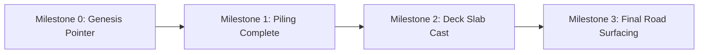

# Verifiable Milestone Attestation Trail for Public Works

## Motivation & Problem Statement
Public infrastructure projects (such as road paving, school renovations, water pipelines, and bridge construction) often suffer from post-hoc alterations of progress records, conflicting milestone claims between contractors and authorities, and lack of citizen transparency.

The Verifiable Milestone Attestation Trail Service anchors cryptographic digests of approved milestone reports and evidence manifests in an immutable append-only trail, allowing citizens and auditors to verify that records have not been retroactively altered.

---

## Architectural Principles & Integrity Invariants



1. **Off-Chain Evidence Storage**:
   - High-resolution survey photographs, contractor invoices, and private geospatial coordinates remain in protected off-chain storage.
   - Only non-personal metadata and SHA-256 evidence digests (`evidenceDigest`) are committed to the trail.
2. **Cryptographic Sequence & Hash Chaining**:
   - Each attestation record computes its hash by incorporating the hash of the preceding milestone (`previousHash`), forming an unbroken chain.
   - Any alteration of previous records or missing sequence entries breaks the chain and triggers immediate verification failure.
3. **Append-Only Corrections**:
   - If a contractor or municipal authority needs to correct a progress entry, a new milestone version is appended; prior entries are never rewritten or deleted.
4. **Clear Legal Distinction**:
   - The user interface explicitly informs citizens: **"Cryptographic proof certifies that records and evidence hashes were published without subsequent alteration. It does not certify physical on-site construction quality."**
5. **Portable Signed JSON Exports**:
   - Complete audit bundles can be exported as structured JSON documents and verified offline without live blockchain connectivity.

---

## Attestation Payload Data Schema

| Field | Type | Description |
| :--- | :--- | :--- |
| `projectId` | `string` | Canonical public works identifier (e.g. `proj_metro_line`) |
| `milestoneIndex` | `number` | Incremental integer sequence position (0, 1, 2...) |
| `milestoneName` | `string` | Official milestone deliverable name |
| `authority` | `string` | Name of approving department or government body |
| `evidenceDigest` | `string` | SHA-256 digest of off-chain inspection photos and reports |
| `previousHash` | `string` | Cryptographic link to previous milestone block or `genesis` |
| `attestationHash` | `string` | Self-contained block verification hash (`att_...`) |

---

## Verification & Execution

Execute unit tests:
```bash
npx vitest run src/services/publicWorksAttestationTrailService.test.js
```
Automated tests validate hash chaining, tamper detection, append-only sequence checks, and portable bundle export.

